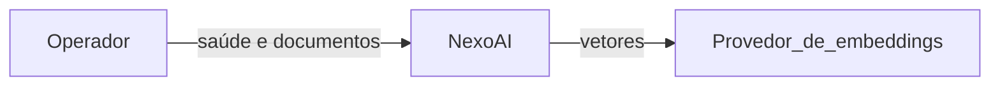
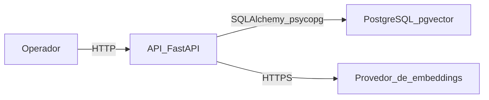
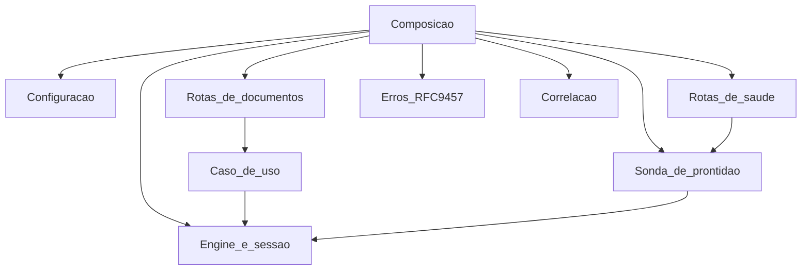

# Arquitetura em C4

Os diagramas descrevem a versão 0.2.0 implementada. A consulta em linguagem natural e a interface não aparecem porque ainda não existem no processo.

## Contexto

O operador usa a API local para verificar a saúde e para enviar documentos. O provedor de embeddings só é chamado na ingestão, quando a chave está configurada.

## Contêineres

A API e o PostgreSQL rodam como dois processos no Compose local. A API abre a conexão com o banco. As tabelas `documents` e `document_chunks` guardam o estágio da ingestão e a coluna `vector(1536)`.

## Componentes da API

O recorte abaixo existe no código atual.

A liveness não passa pela sonda. A readiness chama a sonda, que executa `SELECT 1` e verifica a extensão `vector`. A ingestão percorre extração, fragmentação, embeddings e as tabelas de documento.
