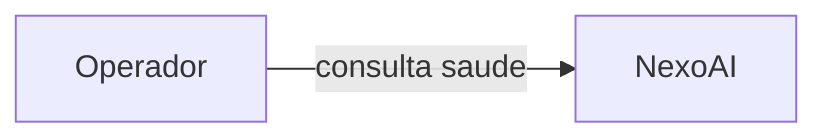
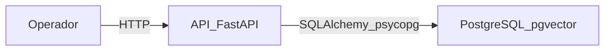
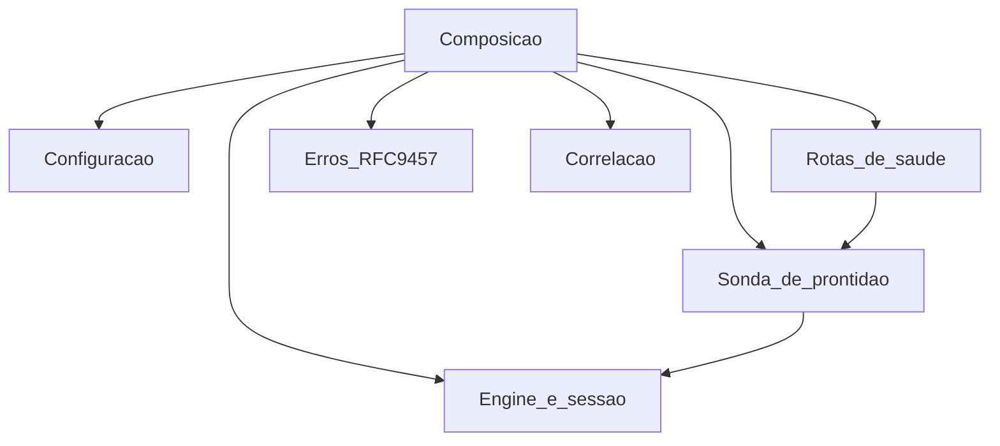

# Arquitetura em C4

Os diagramas descrevem a versão 0.1.0 implementada. Ingestão, embeddings e provedor de linguagem não aparecem como contêineres porque ainda não existem no processo.

## Contexto

O operador usa a API local para verificar se o processo e o banco estão aptos. Não há outro sistema externo conectado.

## Contêineres

A API e o PostgreSQL rodam como dois processos no Compose local. A API é o único componente que abre conexão com o banco. A migration inicial habilita `pgvector`; ainda não há tabela de documentos nem coluna vetorial.

## Componentes da API

O recorte abaixo existe no código atual.

A liveness não passa pela sonda. A readiness chama a sonda, que executa `SELECT 1` e verifica a extensão `vector`.
