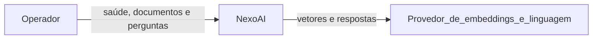
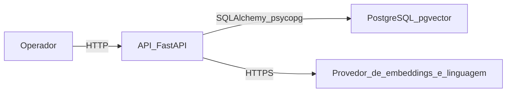
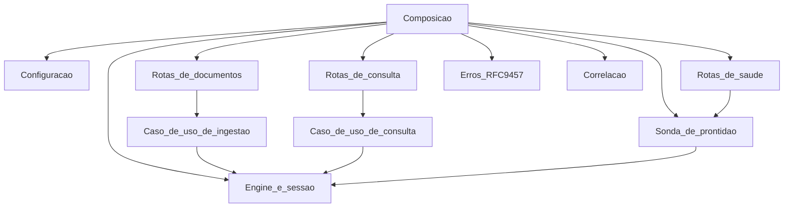

# Arquitetura em C4

Os diagramas descrevem a versão 0.3.0 implementada. A interface não aparece porque ainda não existe no processo.

## Contexto

O operador usa a API local para verificar a saúde, enviar documentos e fazer perguntas. O provedor compatível com a API da OpenAI só é chamado quando a operação precisa dele: embeddings na ingestão e na consulta, linguagem somente quando existe fonte próxima.

## Contêineres

A API e o PostgreSQL rodam como dois processos no Compose local. A API abre a conexão com o banco. As tabelas `documents` e `document_chunks` guardam o estágio da ingestão e a coluna `vector(1536)`. A consulta não cria tabela.

## Componentes da API

O recorte abaixo existe no código atual.

A liveness não passa pela sonda. A readiness chama a sonda, que executa `SELECT 1` e verifica a extensão `vector`. A ingestão percorre extração, fragmentação, embeddings e as tabelas de documento. A consulta percorre o vetor da pergunta, a distância de cosseno e, quando há fonte, a conclusão de linguagem.
